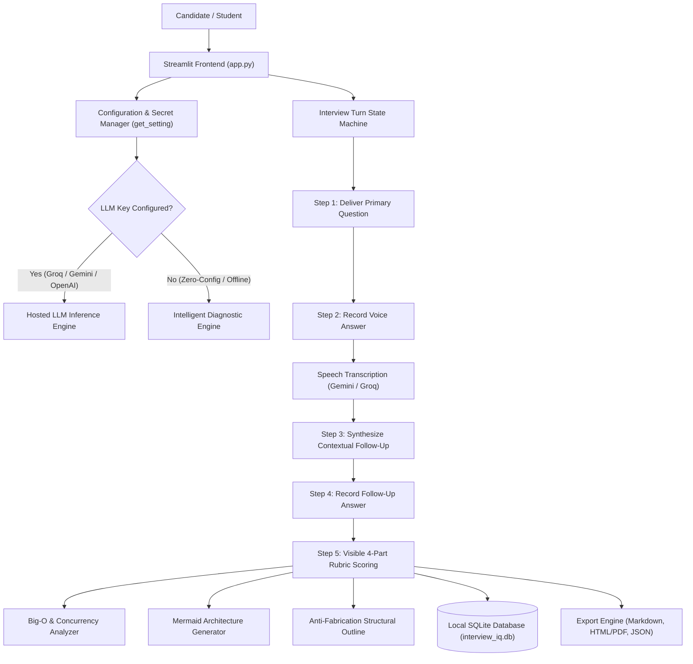

# InterviewIQ: AI Mock Interview & Diagnostic Rubric Studio

> An intelligent, repeatable technical and behavioral interview practice platform that scores student responses against a visible 4-part rubric and generates actionable, non-fabricated improvement roadmaps.

[](https://www.python.org/downloads/)
[](https://streamlit.io)
[](https://github.com/Sur2004/interview_iq/actions/workflows/tests.yml)
[]()
[](LICENSE)

---


## Interview tracks and candidate-material review

Use the **Interview Type** selector in the sidebar to focus a round on one goal:
- **Comprehensive Mixed** — technical, behavioral, and project questions.
- **HR & Behavioral** — motivation, strengths, conflict, feedback, and STAR stories.
- **Managerial & Leadership** — prioritization, delegation, coaching, delivery, and stakeholders.
- **Situational Judgment & Case** — ambiguity, ethical trade-offs, incidents, and decisions.
- **Communication & Stakeholders** — concise explanations, delivery updates, and recommendations.
- **Technical Deep-Dive** or **Project Deep-Dive** — role knowledge and engineering decisions.

The **Resume & Project Review** tab accepts a text-based PDF resume, a public GitHub repository URL, or both. It extracts resume text, reviews a bounded selection of repository text files, suggests improvements, and generates targeted follow-up questions. It does not run repository code or access private repositories.

For hosted evaluation, configure your own API key. Gemini API and Groq may offer free-tier access subject to their current account/model limits; no shared key is bundled. Without a key, the review uses an explicitly labeled offline checklist. See [Free-tier AI setup](docs/FREE_TIER_AI_SETUP.md).


## 1. Problem Statement
Internship and graduate-job applicants frequently struggle during competitive technical and behavioral interview loops. The default reaction for many students is memorizing static, generic answers from question lists. However, when experienced interviewers probe deeper with unscripted follow-up questions regarding edge cases, computational complexity, and architectural trade-offs, memorized scripts quickly fall apart.

Furthermore, existing automated tools often function as opaque "pass/fail" filters, generating unhelpful scores or inventing fictional work experience and unearned metrics in their sample outlines. Students urgently need a **repeatable, transparent practice gym** where they can refine their authentic voice, receive diagnostic rubric feedback, and practice defending their genuine coursework and personal projects.

---

## 2. Objectives
- **Objective 1 (Targeted Simulation):** Provide tailored mock interview rounds of 5–8 questions across Technical, Behavioral, and Project-Explanation domains with persona-driven follow-up questioning.
- **Objective 2 (Transparent Diagnostic Feedback):** Score student responses against a visible 4-part rubric (*Relevance, Structure, Evidence, Clarity*) with explicit scoring anchors and a formative feedback guarantee.
- **Objective 3 (Ethical Coaching without Fabrication):** Offer structural blueprints and framing templates that guide students on how to articulate their real projects without inventing fake companies or inflated metrics.
- **Objective 4 (Deep Technical Telemetry):** Automatically detect Big-O algorithmic complexity, concurrency primitives, and generate dynamic Mermaid architecture diagrams from student answers.
- **Objective 5 (Zero-Friction Deployment):** Support seamless execution locally (via `.env` or `.streamlit/secrets.toml`) and on Streamlit Community Cloud (via `st.secrets`) with a built-in offline diagnostic fallback when no API key is provided.

---

## 3. Features
- **Candidate Profiling:** Configurable target roles (SWE, Frontend, Data Science/ML, AI/LLM Engineering, Cybersecurity, Product Management, DevOps), experience level, and interview focus.
- **Paced Mock Studio:** Presents one question at a time, tracks word count and answer pacing, and delivers an intelligent contextual follow-up probe.
- **Visible 4-Part Rubric:**
  - *Relevance & Directness (1.0–5.0)*
  - *Structure & Framework (1.0–5.0)*
  - *Evidence & Ownership (1.0–5.0)*
  - *Clarity & Communication (1.0–5.0)*
- **Dynamic Technical Telemetry:**
  - Algorithmic Time & Space Complexity detection ($O(1)$, $O(\log N)$, $O(N)$).
  - Concurrency analysis (Mutex, Atomic CAS, Deadlock, Race condition defenses).
  - Dynamic Mermaid Architecture graph generation derived from candidate responses.
- **Dynamic AI Technical Challenge Generator:** Synthesize FAANG/Principal-level technical questions on any custom subsystem (e.g. Kafka, Postgres MVCC, Raft, RAG).
- **Spot the Flaw Interactive Game:** Train an "interviewer's eye" by diagnosing classic candidate errors (*The 'We' Trap*, *Unsubstantiated Metrics*, *The Defensive Blame Game*, *Buzzword Salad*).
- **Interactive STAR Story Builder:** Step-by-step wizard converting raw coursework into structured 90-second interview pitch cards.
- **Local Persistence (SQLite):** Session history, follow-up answers, answer revision history, and historical rubric performance stored in `interview_iq.db`.
- **Audio + Typed Answer Fallback:** Record primary and follow-up answers using Streamlit audio input, or type answers when microphone, internet, or speech-transcription services are unavailable. Audio transcription requires a configured supported provider.
- **Basic Interview Integrity Monitoring:** A browser component requests camera permission for a live preview and reports browser visibility changes. A detected tab/window visibility change terminates the active round and marks it as terminated. A normal web app cannot truly prevent tab switching, browser events can be missed or triggered by benign causes, and this is not tamper-proof proctoring.
- **Answer Revision Workflow:** Edit completed answers where supported, re-score revised responses, and inspect timestamped previous/updated versions in the session transcript and exported reports.
- **Multi-Format Report Export:** Downloadable comprehensive practice summaries in Markdown (`.md`), standalone printable HTML / PDF (`.html`), and machine-readable JSON (`.json`).

---

## 4. Technology Stack
- **Language & Runtime:** Python 3.10+ (Standard Library: `sqlite3`, `dataclasses`, `re`, `json`)
- **Frontend Framework:** Streamlit 1.39+ (for `st.audio_input`)
- **Styling & Visuals:** Sky Blue, White, and Black Cyber-Engineering theme with dynamic CSS animations
- **AI Providers Supported:** Groq Cloud (`llama-3.3-70b-versatile`), Google Gemini (`gemini-3.8-flash`), OpenAI (`gpt-4o-mini`), and Built-In Offline Diagnostic Engine
- **Data & Visualization:** Pandas, Altair, and Mermaid.js for architecture diagrams
- **Configuration & Secrets:** `python-dotenv` and Streamlit `st.secrets`
- **Testing:** Pytest

---

## 5. Architecture



---

## 6. Project Structure

```
interview_iq/
├── app.py                      # Main Streamlit web application & user interface
├── backend/
│   ├── speech.py               # Provider-backed voice transcription
│   ├── __init__.py             # Backend exports
│   ├── config.py               # Secret manager (get_setting) & environment validation
│   ├── models.py               # Data models, RubricScore, EvaluationResult, Disclaimers
│   ├── question_bank.py        # Curated technical, behavioral, & project questions
│   ├── evaluator.py            # AI evaluation engine (Groq, Gemini, OpenAI, & Offline)
│   ├── database.py             # SQLite persistence, turn recording, & analytics
│   └── report_generator.py     # Markdown and standalone HTML/PDF export builders
├── components/
│   └── interview_monitor_v2/
│       └── index.html          # Consent-based camera preview and tab-visibility counter
├── tests/
│   ├── __init__.py
│   └── test_interview_iq.py    # Automated unit and regression tests
├── .streamlit/
│   └── config.toml             # Streamlit server protections and telemetry settings
├── .env.example                # Placeholder environment variable template
├── .gitignore                  # Git exclusion rules (.env and secrets ignored)
├── requirements.txt            # Python package dependencies
├── LICENSE                     # MIT License
└── README.md                   # Project documentation
```

---

## 7. Prerequisites
- **Python:** 3.10 or higher (`python3 --version`)
- **Git:** 2.20 or higher (`git --version`)
- **API Key (Optional):** A Groq Cloud API key (`gsk_...`), Google Gemini key, or OpenAI key. If omitted, the application runs 100% locally using the built-in diagnostic engine.

---

## 8. Installation

1. **Clone the repository:**
   ```bash
   git clone https://github.com/Sur2004/interview_iq.git
   cd interview_iq
   ```

2. **Create and activate a virtual environment:**
   ```bash
   python3 -m venv .venv
   # On macOS/Linux:
   source .venv/bin/activate
   # On Windows (cmd):
   .venv\Scripts\activate.bat
   # On Windows (PowerShell):
   .venv\Scripts\Activate.ps1
   ```

3. **Install dependencies:**
   ```bash
   pip install -r requirements.txt
   ```

4. **Set up local environment variables (Optional):**
   Copy the example file:
   ```bash
   cp .env.example .env
   ```
   Open `.env` in your editor and insert your Groq or Gemini API key. If you leave the placeholders, the app automatically runs in the built-in diagnostic mode.

---

## 9. Run the Application

Launch the application using Streamlit:
```bash
streamlit run app.py
```
Open your browser at **`http://localhost:8501`**.

---

## 10. How to Use

1. **Profile Setup (Sidebar):** Enter your name, choose your target role (e.g. *Software Engineering*), experience level (*Undergraduate Internship*), and select an AI Interviewer persona (e.g. *Jordan - Principal Architect*).
2. **Start Round:** Click **"Start Interview Round"**.
3. **Step 1 (Primary Answer):** Read the prompt on the animated question card. Type your response in the text area. Optionally toggle the code box to provide a Python/Go snippet. Click **"Submit Answer"**.
4. **Step 2 (Contextual Follow-Up):** The AI formulates an unscripted follow-up question in the black-and-blue callout box. Type your answer explaining edge cases or trade-offs and click **"Submit Follow-Up & Score Turn"**.
5. **Step 3 (Diagnostic Results):** Review your 4-part rubric scores (*Relevance, Structure, Evidence, Clarity*), Big-O complexity detection, and the live Mermaid architecture diagram.
6. **Revise an Answer:** Use **Edit answer and refresh feedback** beneath the current turn or completed transcript to revise the main and/or follow-up response and re-score it. The app records previous and updated text with timestamps.
7. **Review Earlier Answers:** While answering a later question, open **Review or edit previous answers** to revisit a completed turn.
8. **Step 4 (Export):** Navigate to the **"Export Practice Report"** tab to download your customized Markdown summary, printable HTML/PDF, or JSON transcript.

---

## 11. Configuration

Environment variables can be configured in a local `.env` file or in Streamlit Community Cloud under **Settings > Secrets**:

| Variable Name | Required | Default | Description |
| :--- | :---: | :---: | :--- |
| `LLM_PROVIDER` | No | `groq` | Selected provider (`groq`, `gemini`, `openai`, or `heuristic`) |
| `GROQ_API_KEY` | No | None | Your Groq Cloud API key (starts with `gsk_`) |
| `MODEL_NAME` | No | `llama-3.3-70b-versatile` | Model identifier for inference |
| `GEMINI_API_KEY` | No | None | Google Gemini API key (optional alternative) |
| `OPENAI_API_KEY` | No | None | OpenAI API key (optional alternative) |

> **Secret Safety Rule:** Never commit real API keys to Git. The `.env` file and `.streamlit/secrets.toml` are ignored by `.gitignore`. Do not commit API keys or credentials. Streamlit's CSRF protection is enabled by default in this project.

---

## 12. Team Roles

- **K. V. N. Surya Teja — Backend and API Developer:** Python backend, LLM integration, question/follow-up flow, speech transcription integration, and answer evaluation.
- **G. Tejesh — Frontend Developer:** Streamlit screens, navigation, UI-to-backend connections, and result presentation.
- **A. Bhagyaraju — UI/UX Designer:** Layout and usability for role selection, question display, audio recording, scores, and feedback.
- **G. Jhon — Documentation:** Project report, technology and workflow descriptions, test cases, limitations, and presentation documentation.

## 13. Testing

Run the automated test suite using Pytest:
```bash
python -m pytest tests/
```

### Test Coverage Summary:
- **`test_behavioral_questions_have_star_hints`**: Verifies STAR hints across competencies.
- **`test_technical_questions_cover_multiple_roles`**: Tests SWE, Frontend, Data Science, AI/LLMs, and Cybersecurity question banks.
- **`test_project_questions_cover_architecture_and_tradeoffs`**: Validates system design challenges.
- **`test_build_interview_plan_respects_limits_and_types`**: Validates 5–8 question mix and pacing.
- **`test_rubric_criteria_metadata`**: Checks 4 criteria and scoring anchors 1 through 5.
- **`test_disclaimer_clarifies_scores_are_practice_not_hiring_predictions`**: Verifies formative practice notice.
- **`test_ethical_guideline_prohibits_fabrication`**: Enforces strict anti-fabrication guardrail.
- **`test_behavioral_evaluation_detects_star_and_scores_accurately`**: Tests STAR heuristic extraction.
- **`test_technical_evaluation_scores_and_probes_tradeoffs`**: Tests technical depth and trade-off scoring.
- **`test_followup_question_generation`**: Validates contextual follow-up generation.
- **`test_sqlite_session_crud_and_analytics`**: Verifies SQLite persistence, loading, and deletion.
- **`test_brief_answer_handling`**: Ensures short answers are graded constructively.
- **`test_all_interview_types_generate_valid_plans`**: Tests all 4 interview modes.
- **`test_technical_complexity_and_dynamic_generator`**: Tests Big-O analyzer, Mermaid diagram generation, and custom topic synthesis.
- **`test_secret_management_and_environment_config`**: Validates `get_setting` fallback, secret masking, and graceful startup messages.
- **Provider-isolation regression:** Confirms a missing selected-provider key falls back to offline evaluation rather than borrowing a different provider's key.
- **Analytics regression:** Confirms unscored sessions are included in counts and session averages are not weighted by turn count.
- **Answer revision persistence:** Confirms the old and revised answer text survive SQLite session save/load.

---

## 13. Screenshots / Demo
- **Live Local URL:** `http://localhost:8501`
- **Streamlit Community Cloud Live Demo:** [Open InterviewIQ](https://interviewiq-jinjpnyj6pmcyodyyjusnj.streamlit.app)
- **Interactive Modules:** Includes *Mock Interview Studio*, *AI Technical Problem Generator*, *Spot the Flaw Game*, *STAR Story Builder*, and *System Design Playbooks*.

---

## 14. Known Limitations
- **Model Hallucinations in Open-Ended Generation:** When using live LLM APIs, rare hallucinations can occur; the application mitigates this by providing heuristic validation and structured JSON schema enforcement.
- **Speech/Voice Latency:** The current release focuses on typed responses to maximize structural reflection and rubric accuracy; live voice streaming is slated for a future iteration.
- **Ephemeral Cloud Storage:** On Streamlit Community Cloud, local SQLite database files are temporary and reset when containers sleep or redeploy.

---

## 15. Privacy and Responsible Use
- **No Private Data Storage:** Do not paste confidential corporate source code, internal credentials, or sensitive personal data.
- **Formative Feedback Notice:** Scores generated by InterviewIQ are educational practice metrics designed to coach communication structure and evidence. They are **not predictive hiring determinations, automated employment screenings, or interview guarantees**.
- **Anti-Fabrication Commitment:** Outlines provide structural templates for framing genuine coursework and projects. We strictly prohibit the generation of fictional company names, false work experience, or unearned credentials.

---

## 16. Future Enhancements
1. **Real-Time Voice Streaming:** Integration with WebRTC and whisper models for low-latency verbal mock interviews.
2. **Interactive Whiteboard / Code Canvas:** In-browser live execution of Python and SQL code test cases.
3. **Multi-Turn Panel Simulation:** Simulated interview panel with simultaneous technical and behavioral interviewers asking branching questions.
4. **ATS Resume Bullet Sync:** Uploading student resumes to automatically extract real projects into the candidate context.

---

## 17. Credits and License
- Developed as part of the **GMRIT Student Project Handbook — Grand AI & NLP Projects** initiative.
- Powered by Streamlit, Groq Cloud, and open-source Python libraries.
- Released under the **MIT License**. See [LICENSE](LICENSE) for details.
